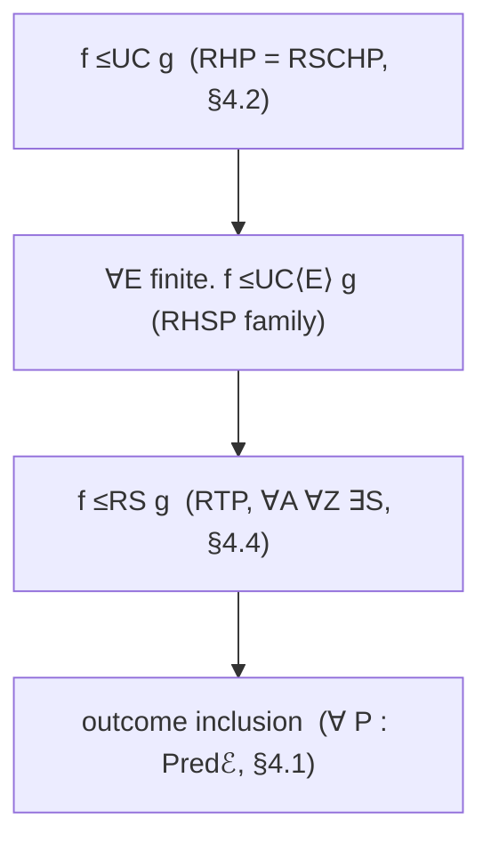

# Robust compilation as a theorem about `≤UC` and its test presheaves

Design study, 2026-10-09. It places "UC is robust compilation" (`patrignani2024`) and its
computational sequel (`patrignani2024csf`) in this library's UC framework. Robust
compilation (RC) appears here as theorems about the emulation order and about a family of
test presheaves. It is not a new model of computation. Code paths are relative to `src/`
on branch `uc-setup-landscape` (`protocol-rewrite` ∪ `machine-iso`). `UC/Robust`,
`UC/Audit`, `UC/Quantitative/*`, `UC/Family/*` and the landscape study
`docs/uc-setup-landscape.md` (§5–§8 point here) are not on `main` yet. §7 records what has
landed and under which names (`UC/Robust/Compilation.agda`, `Examples/RelSetup.agda`); a
name marked *new* that §7 does not list as landed is still a proposal.

## 1. Summary

- **Claim.** `f ≤UC g` iff `f` robustly satisfies every `≈ᵁ`-invariant property of attacked
  programs that `g` does (§4.2). The witness is `Hyp g`; `Robustᵁ (Hyp g) f` *is* `f ≤UC g`,
  so `patrignani2024` Thm 4 and `patrignani2024csf` Thm 3 take two lines here.
- **New theorems:** that equivalence; its per-environment form with an explicit simulator,
  via `∼[_]` (§4.3); trace-property preservation ⇔ RS order ∀A ∀Z ∃S (§4.4, a P24 §8.2.1
  conjecture); the existing env-blind `Robust` class ⇔ outcome inclusion, weaker (§4.1).
- **Dictionary (§3):** P24's Axioms 5–9 are existing theorems (`UC-compose`, `dummy-complete`).
- **Hierarchy (§5):** criteria that change what is observed are test presheaves ordered by
  kernel refinement. Trace, safety, hypersafety and relational criteria move the simulator
  quantifier instead, so no single presheaf expresses them.

## 2. The source notions

`patrignani2024`. Numbering follows the archived arXiv v3.
- §2.1 Def 2: perfect UC emulation, π ⊢UC F ≝ ∀A ∃S ∀Z. Exec(Z,A,π) ≈ Exec(Z,S,F).
  §2.2: traces are pairs (τ, ρ), and Behav(W) is the set of traces of W.
- §2.2 Def 4 (RHP): ⊢⟦·⟧ : RHP ≝ ∀P ∀A ∃A_s. A ⊲⊳ ⟦P⟧ ≏ A_s ⊲⊳ P, where ≏ means equal
  Behav. This is Abate et al.'s property-free RHC. The surrounding prose says
  "subset-closed", but Def 4 is the criterion for all hyperproperties; Def 13 is the
  subset-closed one.
- §3.1: the compiler is partial, ⟦P⟧ ⇀ π, and defined only at the ideal functionality. Its
  roles map as follows: functionality = source program, protocol = compiled program,
  Z = trace prefix, adversary = target context, simulator = source context.
- §3.2: Axioms 1–4 relate ITM executions to traces. They cover the canonical environment
  z(m) and its correctness, completeness of non-probabilistic Z, and the final bit β.
  Thm 1: UC ⟺ RHP for UCLang, proved by contradiction through the axioms.
  Defs 5–7: language/program (pre-)agreement, defined as RHP translations.
  Thm 2: RHP is transitive. Thm 3: RHP for arbitrary languages. Thm 4: the main result.
- §4.1: Thm 6 (composition in RC) follows from Axioms 5–7 (attacker decomposition, FFI
  recombination, constant addition). §4.2: Thm 8 (dummy attacker) follows from Axioms 8–9.
- §8.2.1: RSCHP (Def 13) also coincides with UC (proved in Isabelle; the paper attributes
  the collapse to probability mass 1). RTP (Def 14) differs from RHP only in quantifier
  order. Its match with reactive simulatability (Def 15, ∀A ∀Z ∃S) is conjectured.
  §8.2.2: fully abstract compilation is not UC, because it is relational while UC is
  propositional.

`abate2019journey`. The hierarchy is Fig. 1; the property-free forms are in App. C (Coq).
- §2.1 RTP ⟺ RTC: ∀P ∀C_T ∀t. C_T[P↓] ⇝ t ⇒ ∃C_S. C_S[P] ⇝ t.
  §2.2 RSP ⟺ RSC, the same over finite prefixes m.
- §3.1 RHP ⟺ RHC: ∀P ∀C_T ∃C_S. Behav(C_T[P↓]) = Behav(C_S[P]). Here ∃C_S comes before
  ∀t. §3.2 RSCHP uses ⊆ instead of =. §3.3 RHSP/RKHSP chooses ∃C_S per observation (a
  finite set of finite prefixes). Thm 3.1: RTP ⇏ RTINIP, so trace criteria cannot give
  confidentiality.
- §4.1 R2rHP, RKrHP, RrHP. RrHC is ∀C_T ∃C_S ∀P: one source context for all programs.
- §5: RTEP stands for full abstraction (OEP) in determinate languages. Thm 5.2: RTEP ⇏ RSP.

`patrignani2024csf`.
- Def 5: W₁ ≅ W₂ ≝ ∀Z ∈ PPT. Behav(W₁)|_Z ≈ Behav(W₂)|_Z, with ≈ the ensemble
  indistinguishability of Def 2.
- Def 6 (CRHC): ∀P ∀A. poly(A ⊲⊳ ⟦P⟧) ⇒ ∃A_s. poly(A_s ⊲⊳ P) ∧ A ⊲⊳ ⟦P⟧ ≅ A_s ⊲⊳ P.
- Thm 1: CRHC ⟺ robust preservation of CH = {CH(F)}. Thm 2: CRHC ⟺ ∀P. ⟦P⟧ ⊢UC≈ P; the
  compiler is total.
- §IV: Def 7 PRHC(≡, Q_T, Q_S) and Def 8 PRHP(X, Q_T, Q_S).
  Thm 3: PRHC(≡,Q,Q) ⟺ PRHP(HypCls_{≡,Q}), where HypCls = {Hyp(F)} and
  Hyp(F) = {T | ∃S. Q(S ⊲⊳ F) ∧ T ≡ Behav(S ⊲⊳ F)}. ≡ only needs to be a preorder.
  §IV-A: PRHC(=,True,True) is perfect UC and PRHC(≅_stat,True,True) is statistical UC.
- §V: emulation sets Emul(P). Lemma 4: F ∈ Emul(P) ⟺ Emul(F) ⊆ Emul(P). The proof uses
  reflexivity and transitivity of ≡ and nothing else.

## 3. The dictionary

| RC / UC notion | Agda (exact name; *new* = proposed) | Mismatch |
|---|---|---|
| source / target language S, T | `UCSetup` 𝕊, 𝕊′ (`UCSetup.agda`) | a language has syntax; a setup is semantics up to `𝒞._≈_`, with no program/context syntax split |
| partial program P = ideal functionality F | `g : A 𝒞.⇒ T₀ Y B` | — |
| compiled program ⟦P⟧ = protocol π | `f : A 𝒞.⇒ T₀ X B`; across setups `f′ : F.₀ A S′.𝒞.⇒ S′.T₀ X′ (F.₀ B)` | — |
| compiler ⟦P⟧ ⇀ π (partial, P24 §3.1) | the pair `(g , f)` in one setup (`idᵁ`); across setups `(g , f′)`, judged against `Transfer.G g` (§4.5) | RC compilers are total; CSF Thm 2 restores ∀P, which is pointwise `≤UC` |
| natural translation, (pre-)agreement (P24 Defs 5–7) | `UCSetupMorphism 𝕊 𝕊′`, `Transfer.G f = κ ∘ F.₁ f`; pre-agreement ↦ `Transfer.Preserves-≤UC` | agreement = RHP translations both ways (a Galois insertion, fn. 5); here the two directions are `transfer` and `reflects-≤UC`, with different hypotheses |
| target context A (adversary) | `a : X ℐ.⇒ X′`, acting as `sub a` | contexts are syntax; adversaries are grade morphisms that act through ℳ |
| source context A_s (simulator S) | `s : Y ℐ.⇒ X′`, the Σ in `_≤UC_` | target-language simulators; source-language ones need `Full Φ.F` (§4.5) |
| linking A ⊲⊳ P | `sub a 𝒞.∘ f` | — |
| environment Z ↔ prefix m | ancilla `W : ℐ.Obj` and `e : Env (T₀ (W ⊗₀ X′) B)` | Z is a machine and m a syntactic prefix; `e` is an element of a setoid-valued presheaf, and the closures its equality quantifies over (`Evaluation.Closure`) carry Z's inputs |
| Behav(A ⊲⊳ P), Exec(Z,A,π) | `λ W e → run W (sub a 𝒞.∘ f) e`; its class in `≈ᵁ-setoid A B X′` | one outcome per environment, so Behav is a function, not a set |
| ≏ | `_≈ᵁ_`, read pointwise with `KE.run∼`/`KE.mk∼` (`UC/Quantitative/Bridge.agda:zero-agreement`) | setoid equality instead of trace-set equality |
| trace t, trace property π | `(W , e , outcome)`; `Traceℰ` (*new*) | the existing `Predℰ` is the environment-blind subclass |
| hyperproperty H | `Predᵁ` (*new*): `≈ᵁ`-invariant predicate on attacked programs | invariance is `PredS`'s `cong`; RC sets are extensional by fiat |
| robust satisfaction ∀C. C[P] ⊨ … | `Robust P Adm f` (env-blind); `Robustᵗ`, `Robustᵁ` (*new*) | — |
| RHC / RHP | `_≤UC_` / `≤UC⇔robustᵁ` (*new*) | — |
| Hyp(F), HypCls, Emul(P) (CSF §IV–V) | `Hyp g` (*new*); `{Hyp h}`; Emul(f) = `{g ∣ f ≤UC g}` | — |
| dummy adversary/attacker (P24 Thms 7–8, Axioms 8–9) | `dummy-complete`, `≤UC⇒dummy`, `≤UCᵈ⇔≤UC`; at property level `robust-sub` | here they follow from the grade action; no axioms needed |
| composition (P24 Thm 6, Axioms 5–7) | `UC-compose` | Axioms 5–7 are graded-monad laws (`sub-commute₁/₂`, `∙-decomp`) |
| RHP transitive (P24 Thm 2) | `≤UC-trans`; across setups `transfer` along `composeᵁ` (lemma *new*, §7) | — |
| z(m), Axioms 1–4 | definitional in ℰ. At the model: `UC.Seam.strategyEnv` with `UC.Seam.Adequacy.adequacy` (Axioms 1–2), `UC.Machine.Dominated.dominated` (Axiom 3, closed unit-hole case only), `Evaluation.read` (Axiom 4) | the axioms are about ITMs |
| poly(A ⊲⊳ ⟦P⟧), Z ∈ PPT (CSF Defs 5–6) | `Admissible B d` on environments; `SetupSubcategory.W` on protocols; `Restriction.ℰ′`, certified contexts (`UC.Quantitative.Query.Qᵠ`, `UC.Audit.Permitted`) | CSF's Q is a predicate on the whole linked program; here bounds are compositional hom classes or environment classes |
| poly(A_s ⊲⊳ P) | `ClosedUnder Adm s` (a simulated environment stays admissible); certified simulators `UC.Audit._≤UC[_]_`, `UC.Family` homs | `SetupSubcategory` has `W-sub` for every `c`, so it cannot bound simulators |
| ≡ (CSF: any preorder) | kernel of the test presheaf; `_≈ᵁ[_]_` (ε-graded) | the kernel is an equivalence; fixed-ε closeness is not transitive |
| RTEP / FAC | `Transfer.Preserves-≈ℰ` / plus `Reflects-≈ℰ`, from `ν.Epi` / `ν.Mono` | a property of a translation, not of a pair |
| common trace model (Abate fn. 2, P24 fn. 3) | ν Epi + Mono (iso on kernels); otherwise `Factorization.imageSetup` | — |

## 4. The theorem

§4.1–4.3 live in `UC/Robust/Compilation.agda`'s module `Within setup` (one `setup`), which
opens `UC/Robust.agda` and uses its names: `Predℰ`, `Admissible`, `⊤ᴬ`, `ClosedUnder`,
`Robust`, `robust-resp-≈ᵁ`, `robust-sub`, `uc-preserves`. §4.4 is planned there too.
Throughout, `f : A 𝒞.⇒ T₀ X B` and `g : A 𝒞.⇒ T₀ Y B`.

### 4.1 What `Robust` gives, and why its converse fails

`uc-preserves P ⊤ᴬ (λ _ _ _ _ → tt) : f ≤UC g → Robust P ⊤ᴬ g → Robust P ⊤ᴬ f` holds for every
`P : Predℰ A p`. The converse does not. `P W` sees only the outcome `run W f e`, never the
environment `e` that produced it. That blindness is deliberate
(`docs/history/uc-presheaf-preservation-plan.md` §2.2: "P W deliberately does not depend on
the resource grade"). It means the class only characterises outcome inclusion (*new*):

```agda
robust⇔outcomes : ((P : Predℰ A (cs ⊔ ℓs)) → Robust P ⊤ᴬ g → Robust P ⊤ᴬ f) ⇔ f ⊆ᵒ g
-- f ⊆ᵒ g = ∀ W (e : Env (T₀ (W ⊗₀ X) B)) → ∃[ e′ ] run W f e Env.≈ run W g e′
-- ⇐: `outcomes⇒robust`, level-polymorphic.   ⇒: P W = record { to = λ x → ∃[ e′ ] x Env.≈ run W g e′ ; … }
```

The strictness witness is already in the tree. In `Examples/RelSetup.agda`,
`leaky-not-secure : ¬ relayPlain ≤UC sendIdeal`, yet outcome inclusion holds with
`e′ ((w , _) , b) := e ((w , b) , b)`. Both sides run to `(w , m) ↦ e ((w , m) , m)`.
`relay-outcomes` proves it: `relay-copy : relayPlain ≈ copy ∘ sendIdeal` with
`copy (_ , m₀) (t , m′) = t ≡ m₀ × m₀ ≡ m′`, so `e′ = pull ((μ W Msg ∘ T₁ W copy) ∘ α⇒) e`.
So every environment-blind property that the ideal channel robustly has, the leaky relay has
as well, at every level: `blind-incomplete` refutes the ← direction of the `Predℰ` version.
This is Abate Thm 3.1 (RTP ⇏ RTINIP) in miniature: blind properties cannot state
confidentiality.

### 4.2 Single setup, property-full: `≤UC` is RHP

```agda
Predᵁ : (A B : 𝒞.Obj) (p : Level) → Set (o ⊔ ℓ′ ⊔ cs ⊔ ℓs ⊔ suc p)
Predᵁ A B p = (X′ : ℐ.Obj) → PredS (≈ᵁ-setoid A B X′) p

Robustᵁ : Predᵁ A B p → A 𝒞.⇒ T₀ X B → Set (o ⊔ ℓ ⊔ p)
Robustᵁ {X = X} H f = ∀ {X′} (a : X ℐ.⇒ X′) → H X′ ⟨$⟩ (sub a 𝒞.∘ f)

-- `patrignani2024csf` §IV's Hyp(F): "is a simulated g"
Hyp : A 𝒞.⇒ T₀ Y B → Predᵁ A B (o ⊔ ℓ ⊔ cs ⊔ ℓs)
Hyp {Y = Y} g X′ = record
  { to   = λ h → Σ[ s ∈ Y ℐ.⇒ X′ ] h ≈ᵁ sub s 𝒞.∘ g
  ; cong = λ u → mk⇔ (λ (s , v) → s , ≈ᵁ-trans (≈ᵁ-sym u) v) (λ (s , v) → s , ≈ᵁ-trans u v) }

≤UC⇒robustᵁ : f ≤UC g → (H : Predᵁ A B p) → Robustᵁ H g → Robustᵁ H f
≤UC⇒robustᵁ le H rob a = let s , u = le a in Equivalence.from (Func.cong (H _) u) (rob s)

robustᵁ⇒≤UC : ((H : Predᵁ A B (o ⊔ ℓ ⊔ cs ⊔ ℓs)) → Robustᵁ H g → Robustᵁ H f) → f ≤UC g
robustᵁ⇒≤UC pres = pres (Hyp g) (≤UC-refl g)

≤UC⇔robustᵁ : f ≤UC g ⇔ ((H : Predᵁ A B (o ⊔ ℓ ⊔ cs ⊔ ℓs)) → Robustᵁ H g → Robustᵁ H f)

-- every level above the principal one, via `liftᵁ q H X h = Lift q (H X ⟨$⟩ h)`
≤UC⇔robustᵁ↑ : f ≤UC g ⇔ ((H : Predᵁ A B (o ⊔ ℓ ⊔ cs ⊔ ℓs ⊔ p)) → Robustᵁ H g → Robustᵁ H f)
```

**→** is `robust-resp-≈ᵁ`'s argument moved one level up. Unpack the simulator from `le a`,
take `rob s`, and transport along the `≈ᵁ`-congruence of `H`. Nothing is needed: no
`ClosedUnder` (the attack is on the program, not the environment) and no `GradeStable`.
**←** uses the fact that `Robustᵁ (Hyp g) f` unfolds definitionally to `f ≤UC g`, and
`Robustᵁ (Hyp g) g` to `g ≤UC g`, which is `≤UC-refl g`. Only principal properties are
used. That gives CSF Thm 3 / Lemma 4 as a corollary, in `Abstract2` (*new*):
`≤UC⇔principal : f ≤UC g ⇔ (∀ {Z} (h : A 𝒞.⇒ T₀ Z B) → g ≤UC h → f ≤UC h)`, which follows
from `≤UC-trans` and `≤UC-refl`. This is the Yoneda lemma for a preorder. RSCHP adds
nothing: behaviours are total functions of `e`, so inclusion of graphs is equality. That is
P24 §8.2.1's collapse, for a structural reason rather than a probabilistic one.

### 4.3 Simulator explicit, per environment: the kernel-equality predicate

```agda
Traceℰ : (A B : 𝒞.Obj) (X : ℐ.Obj) (p : Level) → Set (o ⊔ cs ⊔ ℓs ⊔ suc p)
Traceℰ A B X p = (W : ℐ.Obj) → Env (T₀ (W ⊗₀ X) B) → PredS (ℰ.₀ (T₀ W A)) p

Robustᵗ : Traceℰ A B X p → Admissible B d → A 𝒞.⇒ T₀ X B → Set (o ⊔ cs ⊔ d ⊔ p)
Robustᵗ {X = X} P Adm f = ∀ W e → Adm W X e → P W e ⟨$⟩ run W f e

robust≡robustᵗ : (P : Predℰ A p) (Adm : Admissible B d) (f : A 𝒞.⇒ T₀ X B)
               → Robust P Adm f ≡ Robustᵗ (λ W _ → P W) Adm f
robust≡robustᵗ _ _ _ = refl

≈ᵁ⇔robustᵗ : {h k : A 𝒞.⇒ T₀ X B}
           → h ≈ᵁ k ⇔ ((P : Traceℰ A B X ℓs) → Robustᵗ P ⊤ᴬ k → Robustᵗ P ⊤ᴬ h)

≤UC⇔robustᵗ : f ≤UC g ⇔ (∀ {X′} (a : X ℐ.⇒ X′) → Σ[ s ∈ Y ℐ.⇒ X′ ]
                ((P : Traceℰ A B X′ ℓs) → Robustᵗ P ⊤ᴬ (sub s 𝒞.∘ g) → Robustᵗ P ⊤ᴬ (sub a 𝒞.∘ f)))
```

**→** (of `≈ᵁ⇔robustᵗ`) is `robust-resp-≈ᵁ` verbatim with `P W e` for `P W`.
**←** instantiates `P` with the kernel-equality predicate `λ W e → ∼[ run W k e ]` from
`Relation.Binary.Properties.Setoid.Ext` at `ℰ.₀ (T₀ W A)`. `Robustᵗ` of it at `k` is
`λ _ _ _ → Env.refl`. At `h` it gives `run W k e Env.≈ run W h e` for all `W e`, and
`λ W → KE.mk∼ λ {e} → Env.sym …` assembles that into `h ≈ᵁ k` (the shape of
`zero-agreement⇐`). `≤UC⇔robustᵗ` then follows pointwise under `∀ a Σ s`. The simulator
has to be explicit here. A `Traceℰ` at grade `X′` has no transport to `g`'s grade `Y`
(this is the premise the history plan refuses to hide), and `s` *is* that transport, by
`run-sub`. With `Adm` in place of `⊤ᴬ`, ← yields agreement on admissible environments only
(§6).

### 4.4 Moving ∃s inside ∀e: trace properties are reactive simulatability (*new*)

```agda
_≤RS_ : A 𝒞.⇒ T₀ X B → A 𝒞.⇒ T₀ Y B → Set (o ⊔ ℓ ⊔ cs ⊔ ℓs)
_≤RS_ {X = X} {Y} f g = ∀ {X′} (a : X ℐ.⇒ X′) W (e : Env (T₀ (W ⊗₀ X′) B))
                      → Σ[ s ∈ Y ℐ.⇒ X′ ] run W (sub a 𝒞.∘ f) e Env.≈ run W (sub s 𝒞.∘ g) e

Robustᵗ⁺ : ((X′ : ℐ.Obj) → Traceℰ A B X′ p) → A 𝒞.⇒ T₀ X B → Set (o ⊔ ℓ ⊔ cs ⊔ p)
Robustᵗ⁺ P f = ∀ {X′} (a : X ℐ.⇒ X′) W e → P X′ W e ⟨$⟩ run W (sub a 𝒞.∘ f) e

≤RS⇔robustᵗ⁺ : f ≤RS g ⇔ ((P : (X′ : ℐ.Obj) → Traceℰ A B X′ (ℓ ⊔ ℓs)) → Robustᵗ⁺ P g → Robustᵗ⁺ P f)
-- ⇐: P X′ W e = record { to = λ x → Σ[ s ∈ Y ℐ.⇒ X′ ] x Env.≈ run W (sub s 𝒞.∘ g) e ; … }
```

Robust preservation of all trace properties (RTP) gives RS (∀A ∀Z ∃S), and all
hyperproperties give UC (∀A ∃S ∀Z), exactly as the RC hierarchy predicts. The chain
`f ≤UC g → f ≤RS g → outcome inclusion` holds by `KE.run∼` and then by `run-sub` at
`a = ℐ.id` with `sub-identityˡ`. For the second link, `relayPlain`/`sendIdeal` shows
strictness: no `s : unit ⇒ Msg` matches `e = {((w,true),true), ((w,true),false)}`.
Strictness of the first link in some concrete setup is open (§6).

### 4.5 Two setups: the compiler along `𝕄 : UCSetupMorphism 𝕊 𝕊′`

The common trace model is the target. P24 Thm 4, with 𝕊′ playing UCLang, becomes
definitional (proposed for module `Along 𝕄` of `UC/Robust/Compilation.agda`, which opens
`Transfer 𝕄`; not landed, §7 item 7):

```agda
RHC : A S.𝒞.⇒ S.T₀ Y B → F.₀ A S′.𝒞.⇒ S′.T₀ X′ (F.₀ B) → Set _
RHC g f′ = f′ S′.≤UC G g

RHCˢ : A S.𝒞.⇒ S.T₀ Y B → F.₀ A S′.𝒞.⇒ S′.T₀ (Φ.₀ X) (F.₀ B) → Set _   -- source-language simulators
RHCˢ {Y = Y} {X = X} g f′ = Σ[ s ∈ Y S.ℐ.⇒ X ] f′ S′.≈ᵁ S′.sub (Φ.₁ s) S′.𝒞.∘ G g

RHCˢ⇒RHC : RHCˢ g f′ → RHC g f′                    -- λ (s , u) → S′.dummy-complete (Φ.₁ s , u)
RHC⇒RHCˢ : Full Φ.F → RHC g f′ → RHCˢ g f′         -- reflects-≤UC's first step
compile  : ν.Epi → S′.GradeStable → f S.≤UC g → f′ S′.≤UC G f → RHC g f′
compile epi gs le le′ = S′.≤UC-trans le′ (transfer epi gs le)   -- P24 Thms 2–3
```

The property form is §4.2 inside 𝕊′:
`RHC g f′ ⇔ ∀ H′. S′.Robustᵁ H′ (G g) → S′.Robustᵁ H′ f′`. At `f′ = G f` it has landed in
`Along 𝕄`, with `R′ = Within 𝕊′` and `p₀′ = o₂ ⊔ ℓ₂ ⊔ cs ⊔ ℓs`:

```agda
robustᵁ-transfer  : ν.Epi → S′.GradeStable → f S.≤UC g
                  → (H : R′.Predᵁ (F.₀ A) (F.₀ B) p) → R′.Robustᵁ H (G g) → R′.Robustᵁ H (G f)
robustᵁ-reflect   : Full Φ.F → κ-Mono → ν.Mono → S.GradeStable
                  → ((H : R′.Predᵁ (F.₀ A) (F.₀ B) p₀′) → R′.Robustᵁ H (G g) → R′.Robustᵁ H (G f))
                  → f S.≤UC g
≤UC⇔robustᵁ-along : ν.Epi → S′.GradeStable → Full Φ.F → κ-Mono → ν.Mono → S.GradeStable
                   → f S.≤UC g ⇔ ((H : R′.Predᵁ (F.₀ A) (F.₀ B) p₀′) → R′.Robustᵁ H (G g) → R′.Robustᵁ H (G f))
```

They are `R′.≤UC⇒robustᵁ ∘ transfer` and `reflects-≤UC ∘ R′.robustᵁ⇒≤UC`. What
`Abstract2/Morphism` gives, and where ν enters:

| Direction | Lemma | Hypotheses | RC reading |
|---|---|---|---|
| `f ≤UC g → G f ≤UC′ G g` | `Transfer.transfer` | `ν.Epi`, `S′.GradeStable` | every target test on `F.₀ A` is a translated source test. This is backtranslation, moved from contexts to environments by the dummy theorem. GradeStable bridges target prefixes that are not `Φ.₀ W` |
| `G f ≤UC′ G g → f ≤UC g` | `Transfer.reflects-≤UC` | `Full Φ.F`, `κ-Mono`, `ν.Mono`, `S.GradeStable` | target simulators backtranslate (Full); translated programs stay separated (Mono) |
| same 𝒞/ℐ/ℳ, coarser ℰ′ | `Refine.≤UC-refine` | `refineℰ` alone, e.g. `epi⇒preserves`/`mono⇒reflects` of a `changeKernel` ν | inclusion of criteria, with no GradeStable |
| any 𝕄 | `Factorization.coarsen-to-image` then `image-morphism` | `toImage-epi`, `fromImage-mono` (free) | makes RC's common-trace-model assumption true by construction |

### 4.6 Approximate: the graded Yoneda (*new*, `UC/Quantitative/Witness.agda`)

CSF Lemma 4 needs ≡ to be transitive, and fixed-ε closeness is not. The principal form
therefore becomes graded, using only `at-trans`, `ctx-mono` and `⊕-identityʳ`:

```agda
witness-yoneda : Witness ε f g ⇔ (∀ δ {Z} (h : A 𝒞.⇒ T₀ Z B) → Witness δ g h → Witness (ε ⊕ δ) f h)
-- ⇐: h = g, δ = ε₀, (ℐ.id , ≈C⇒ctx (𝒞.Equiv.sym (sub-identityˡ g))), then ctx-mono ⊕-identityʳ
```

Each `Hypᵋ g δ X′ h = Σ[ s ] h ≈ᵁ[ δ ] sub s 𝒞.∘ g` respects the exact `≈ᵁ` (by `≈-resp₀`),
so `Robustᵁ (Hypᵋ g δ) f ⇔ Witness⁺ δ f g`. Where the kernel is an equivalence, as at
`underlying₊ R` (`positive-emulation`) and `ucSetupᴺ`, §4.2 applies verbatim.

## 5. The criteria hierarchy as presheaves

Every row below shares one 𝒞/ℐ/ℳ. Weaker criterion = coarser kernel.

| Criterion (source) | Presheaf or construction | Relation | In tree |
|---|---|---|---|
| RHP (Abate §3.1; P24 Def 4; CSF Prop 1) | the setup's ℰ: `ℰᵒ` (`UC/Model/Setup.agda`), generally `Observable.ℰᴼ` / `Evaluation.Pᴱ` (`UC/Core.agda`) | `_≤UC_` (§4.2) | yes |
| RSCHP (Abate §3.2; P24 Def 13) | same ℰ | `_≤UC_`; it collapses into RHP (§4.2) | nothing to add |
| RHSP, RKHSP (Abate §3.3) | sub-presheaves `ℰ⟨E⟩ ↪ ℰ` generated by finite sets E of finite-horizon environments, via `reobserve` | ∀E. `f ≤UC⟨E⟩ g` (simulator per orbit); faithful form: `_≤RS_` with ∃s per finite family | new |
| RTP (Abate §2.1; P24 Def 14) | cyclic `ℰ⟨e⟩` | RTP itself is exactly `_≤RS_` (§4.4); the presheaf encoding ∀e. `f ≤UC⟨e⟩ g` lies between `≤UC` and `≤RS` | new |
| RSP (Abate §2.2) | `ℰ⟨e⟩` for finite-horizon `e`. The tree's one-sided event observations (`UC.Machine.Monitor.flagReader`, `UC.Machine.StateEvent`, `UC.Audit`) are its bounded form | `_≤RS_` over finite-horizon `e` | events yes; presheaf new |
| RDP (Abate App. B) | none: a `Dₚ` outcome already records divergence as missing mass | — | n/a |
| single property (RTINIP, …) | one `H : Predᵁ` | `Robustᵁ H g → Robustᵁ H f` | instance |
| environment-blind (no RC row) | `Predℰ`; `always` (`UC/Core.agda`) lifts an observation predicate to tests over all closures (`UC/Robust/Model.agda` uses `always ∼[ r ]`) | outcome inclusion (§4.1) | yes |
| R2rHP, RKrHP, RrHP (Abate §4.1) | not a presheaf: one simulator for a family of programs | ∀a ∃s ∀i. `sub a ∘ fᵢ ≈ᵁ sub s ∘ gᵢ` | new relation |
| RTEP, OEP/FAC (Abate §5; P24 §8.2.2) | ν of a setup morphism | `Preserves-≈ℰ` (`ν.Epi`), `Reflects-≈ℰ` (`ν.Mono`) | yes |
| CRHC = PRHC(≅,poly,poly) (CSF Defs 6–7, Thms 1–3) | `Evaluationᴺ`, setup `ucSetupᴺ` (`UC/Family/Negligible/Setup.agda`). Homs (protocols, simulators, tests) are certified, and the negligible witness is local per context, matching CSF's per-Z ≅ | `≤UC` there; CSF Thm 1 = §4.2 with `Hyp g` = CH(F) | yes; theorem new |
| PRHC(≅_stat,True,True) (CSF §IV-A) | a family readout over uncertified contexts | — | new; see §6 |
| global negligible schedule | `_≈ℰⁿ_` (`UC/Family.agda`) | stronger than CSF's ≅; `≤UCˢ⇒≤UCᴺ` holds one way | yes |
| vanishing / all positive ε | `ucSetup^ω`; `underlying₊ R` | `≤UC^ω⇒≤UC₊`, `≤UC₊⇒≤UC^ω`; `positive-emulation` | yes |
| ε-RHC at fixed ε | `UC/Quantitative/Observed.agda`: `Q`, `QSetup`, `Quant = QBridge QSetup`, `_≈ℰ[_]_`, `≈ℰ[]⇔≈ᵁ[]` | `Quant.Witness ε` ⇔ `Quant.Witness⁺ ε` (`dummy⇒universal`); not a setup's `≤UC` | relation yes; §4.6 new |
| one-sided event bounds (approximate RSP) | `UC.Audit`: `Permitted`, `Absorbs`, `AuditBound` | `audit-carry`, the quantitative twin of `uc-preserves-at` | yes |

The order between criteria is kernel refinement. For a sub-presheaf inclusion
`ι : ℰ⟨E⟩ ↪ ℰ`, `refineℰ` restricts the pointwise equality. When the levels agree it is
`mono⇒reflects` of `changeKernel ℰ⟨E⟩ ℰ ι` read backwards. `≤UC-refine` of
`Refine 𝕊 ℰ⟨E⟩ refineℰ` then turns RHP into the E-criterion, and likewise for E ⊆ E′.
Quotient observations (forgetting the error, or `image ν`) use `epi⇒preserves`, through
`Refine` or `Factorization.coarsen-to-image`.



## 6. Hard parts and risks

- **Levels.** `∀ (H : Predᵁ A B p)` lives one universe above `f ≤UC g : Set (o ⊔ ℓ ⊔ cs ⊔ ℓs)`.
  Agda cannot write "for all p" inside `_⇔_`, because that is `Setω`. So the ← direction
  fixes `p₀ = o ⊔ ℓ ⊔ cs ⊔ ℓs` for `Hyp` (`ℓs` suffices for `∼[_]`, `ℓ ⊔ ℓs` for §4.4,
  `cs ⊔ ℓs` for §4.1). The → directions stay level-polymorphic, and `Lift` covers
  `p ≥ p₀`: `≤UC⇔robustᵁ` is the `p₀` form and `≤UC⇔robustᵁ↑` the form at every
  `p₀ ⊔ p`, through `liftᵁ`. At the model every level is `suc 0ℓ`.
  Impredicativity: RC's ∀H ranges over 2^(2^Trace), which is unproblematic in Isabelle/HOL.
  Here only the principal class is ever instantiated, so the theorem does not depend on
  which level is chosen.
- **`Respects≈Env`.** `Predℰ`, `Traceℰ` and `Predᵁ` respect the outcome or program setoid
  by construction (`PredS`'s `cong`). `Traceℰ`'s dependence on `e` needs no respect for
  either direction, and `∼[ run W k e ]` respects it anyway by `pull-cong`. With
  `Adm ≠ ⊤ᴬ`, §4.3's ← gives agreement on admissible environments only. That is a setup's
  `≈ᵁ` only when Adm is the trace of a sub-presheaf, which requires `Respects≈Env` plus
  stability under pulls along all prefix/`ext`/`sub` maps. `ClosedUnder` covers `sub` only.
  `Factors V` has `factors-resp` and `factors-closed`; stability under `ext` is unproved.
- **`GradeStable` and faithfulness.** §4.1–4.4 need neither, because they are stated over
  `≈ᵁ`. If properties were stated over the bare `≈ℰ-setoid` (dropping the ancilla `W`), ←
  would land in `≈ℰ`, and `bridge gs` would be needed to reach `≈ᵁ`. Faithfulness only
  implies GradeStable (`faithful⇒grade-stable`). Across setups, `transfer` needs
  `S′.GradeStable` and `reflects-≤UC` needs `S.GradeStable`; `Refine` needs neither.
- **Levels of new presheaves.** `ℰ⟨E⟩`'s carrier `Σ (x : Env D) (x ∈ ⟨E⟩)` sits at
  `cs ⊔ ℓ′ ⊔ …`, while `changeKernel` and `UCSetupMorphism` fix `cs ℓs` literally. The
  hierarchy therefore goes through `reobserve`/`Refine`, which allow `cs′ ℓs′`.
- **Closures.** In observation-generated setups the `ℰ`-equality quantifies over closures
  (Z's inputs) after `s`. So `_≤RS_` is ∀A ∀(test part of Z) ∃S ∀(closure). Full RS, with S
  chosen after the closure as well, exists only at the `UC/Core.agda` presentation and is
  model-specific.
- **Where the papers do not transfer.**
  - Per-trace and relational criteria move ∃s or ∀P past ∀e, which a test presheaf cannot
    express.
  - `_≤RS_` is a preorder, but no `UC-compose` analogue follows from the graded-monad laws:
    `UC-compose`'s proof spends one simulator for all environments [INFERENCE].
  - `≤RS ⇏ ≤UC` is not exhibited in any setup here. P24 §8.2.1 reports, via Küsters et al.,
    that RS ≠ UC for Canetti's UC.
  - CSF's Q is a predicate on whole linked programs, not compositional. Its "no optimising
    super-polynomial programs" remark is our `ClosedUnder` being a premise.
  - Statistical UC needs unbounded contexts. The family readout needs certified contexts
    to define its error (`UC/Family.agda`, the comment on `_≈ℰ[_]_`), so a statistical
    tier is a new readout, not an instance.
  - Pulling a target hyperproperty back along `G` only sees attackers of the form `Φ.₁ a`.
    Recovering 𝕊′-robustness needs `Full Φ.F`, essential surjectivity of Φ on grades, and
    invariance of `H′` under regrading isomorphisms. That is RC's context backtranslation,
    which UC's dummy theorem avoids (§4.5 uses target simulators).
  - P24's Axioms 1–4 have no abstract counterpart. Whether `ℰᵒ`'s kernel is trace
    equivalence is the open full-abstraction question of landscape §4.
- **Instantiation cost.** A generic theory applied at `StdSetup` has been measured to cost
  time (+22 s for one module application, `docs/quantitative-family.md`). Keep model
  instances in their own leaf modules.

## 7. Work breakdown

Every step's acceptance includes
`pagda --useUntracked false check src/<Path>.agda -- +RTS -M3G -H1G -RTS` green with an
empty warning grep, plus its in-repo importers. The work ends with the closure check
(`*Tests`, `CategoricalCrypto`) and an unchanged escape-hatch baseline.

Status (branch `robust-lemma`). All single-setup names are in `Within` of
`UC/Robust/Compilation.agda`, not in `UC/Robust.agda`, so `UC/Robust.agda` and its importer
`UC/Robust/Model.agda` are unchanged. `Examples/RelSetup.agda` is now an example leaf of
the root `CategoricalCrypto`, which makes it reach `UC/Robust/Compilation.agda`.

| Item | Status | Landed names |
|---|---|---|
| 1 | landed in `Within` | `Traceℰ`, `Robustᵗ`, `robust≡robustᵗ` (the `refl` test), `robustᵗ-resp-≈ᵁ`, `≈ᵁ⇔robustᵗ` |
| 2 | landed in `Within` | `Predᵁ`, `Robustᵁ`, `Hyp`, `liftᵁ`, `≤UC⇒robustᵁ`, `robustᵁ⇒≤UC` (`pres (Hyp g) (≤UC-refl g)`, no conversion), `≤UC⇔robustᵁ`, `≤UC⇔robustᵁ↑`, `≤UC⇔robustᵗ` |
| 3 | open | — |
| 4 | §4.1 part landed in `Within` | `_⊆ᵒ_`, `outcomes⇒robust`, `robust⇔outcomes`; `_≤RS_`, `Robustᵗ⁺`, `≤RS⇔robustᵗ⁺`, `≤UC⇒≤RS`, `≤RS⇒outcomes` open |
| 5 | outcome half landed | `copy`, `relay-copy`, `relay-outcomes`, `blind-incomplete` (no `Predℰ` level makes blind robustness imply `≤UC`); `relay-not-RS` open, it needs `_≤RS_` |
| 6 | open | — |
| 7 | property form landed in `Along 𝕄` | `robustᵁ-transfer`, `robustᵁ-reflect`, `≤UC⇔robustᵁ-along`; `RHC`, `RHCˢ`, the conversions and `compile` are open. Sharing `RHC⇒RHCˢ`'s step means factoring `reflects-≤UC`'s `dummy` out in `Abstract2/Morphism.agda`, whose importers include `ITM/Setup`, `UC/Family/*` and `UC/RandomSystems/Morphism` |
| 8–11 | open | — |

1. **`UC/Robust.agda` (traces).** Add `Traceℰ`, `Robustᵗ`, `robustᵗ-resp-≈ᵁ` and
   `≈ᵁ⇔robustᵗ`. *Accept:* `Robust P Adm f` and `Robustᵗ (λ W _ → P W) Adm f` are
   convertible (a `refl` test); `uc-preserves*` statements are untouched;
   `UC/Robust/Model.agda` is green.
2. **`UC/Robust.agda` (hyperproperties).** Add `Predᵁ`, `Robustᵁ`, `Hyp`, `≤UC⇒robustᵁ`,
   `robustᵁ⇒≤UC`, `≤UC⇔robustᵁ` and `≤UC⇔robustᵗ`. *Accept:*
   `robustᵁ⇒≤UC pres = pres (Hyp g) (≤UC-refl g)` checks with no conversion lemma.
3. **`Abstract2.agda`.** Add `≤UC⇔principal` next to `≤UC-trans`. *Accept:* green, plus
   the full closure, since `AbstractUC` is opened publicly downstream.
4. **`UC/Robust.agda` (orders).** Add `_≤RS_`, `Robustᵗ⁺`, `≤RS⇔robustᵗ⁺`, `≤UC⇒≤RS`,
   `≤RS⇒outcomes` and `robust⇔outcomes`. *Accept:* green.
5. **`Examples/RelSetup.agda`.** Add `relay-outcomes` (outcome inclusion for
   `relayPlain`/`sendIdeal`) and `relay-not-RS : ¬ relayPlain ≤RS sendIdeal`. *Accept:*
   both proved; together with `leaky-not-secure` they pin §4.1/§4.4's strictness.
6. **`Abstract2/Morphism.agda` and `Categories/Functor/Presheaf/Morphism.agda`.** Add
   `G` of `composeᵁ` ≈ `G′ ∘ G`, `preserves-∘ᵁ`, `∘ᵛ-epi` and `∘ᵛ-mono`. *Accept:* green;
   P24 Thm 2 across setups is a corollary.
7. **`UC/Robust/Compilation.agda` (new, parameterised by `𝕄`).** Add `RHC`, `RHCˢ`, both
   conversions, `compile` and the §4.2 form in 𝕊′. *Accept:* green; `RHC⇒RHCˢ` shares the
   dummy-and-fullness step with `reflects-≤UC` instead of copying it.
8. **`Categories/Functor/Presheaf/Sub.agda` (new, general).** Add the sub-presheaf
   generated by a family of elements; when the levels agree, also its `Mono` inclusion. Then
   **`UC/Robust/Hierarchy.agda`**: `_≤UC⟨_⟩_` via `reobserve`, `≤UC⇒≤UC⟨⟩` via `Refine`
   (restricting the pointwise equality), and `≤UC⟨⟩⇒≤RS`. *Accept:* the §5 diagram as four
   green lemmas.
9. **`UC/Quantitative/Witness.agda`.** Add `witness-yoneda`. *Accept:* green.
10. **Instances.** Instantiate `≤UC⇔robustᵁ` and `≤UC⇔robustᵗ` at
    `UC.Model.Setup.StdSetup` in `UC/Robust/Model.agda`, and at `ucSetupᴺ` (CSF Thm 1) in a
    new leaf `UC/Family/Negligible/Robust.agda`. *Accept:* warm checks within
    60 s + LOC/4 s.
11. **Docs.** On landing, replace `docs/kb/core/03-related-frameworks.typ`'s verdict
    "mechanically orthogonal" with pointers to the theorems, and link this file from
    `docs/uc-setup-landscape.md` §5–§8.

## 8. Sources

Bibkeys: `patrignani2024`, `patrignani2024csf`, `abate2019journey` (`docs/kb/refs.bib`;
the `abate2019journey` entry is new, next to `patrignani2024csf`). Newly archived in the
integration worktree's `docs/kb/sources/papers/`, each with an `INDEX.md` line:
`patrignani2024.pdf`/`.txt` (arXiv:1910.08634v3), `patrignani2024csf.pdf`/`.txt`
(arXiv:2401.15041v1) and `abate2019journey.pdf`/`.txt` (arXiv:1807.04603v6). No download
was blocked.
